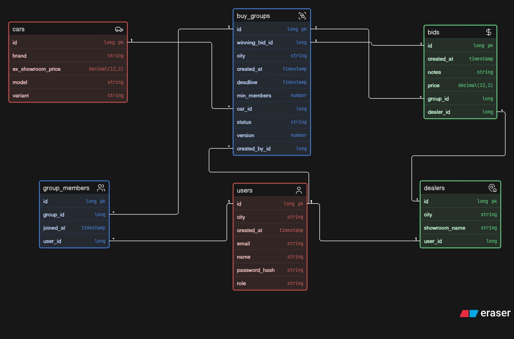

# carbid

Backend for a group car-buying platform. Buyers form a group for the same car in their city,
dealers bid in a reverse auction, and the lowest bid wins.

**Live API docs:** https://carbid-jhga.onrender.com/swagger-ui.html
The free host sleeps when idle, so the first request can take about a minute.

## What it does
- Buyers register, create or join groups, and browse groups in their city
- A group moves OPEN -> BIDDING when enough buyers join
- Dealers (created by an admin) place strictly lower bids; the lowest wins when bidding ends
- A scheduled job expires groups and locks the winning bid

## Tech
Java 25, Spring Boot 4, Spring Security (JWT, role-based access), Spring Data JPA,
PostgreSQL (Supabase), Flyway, Docker, OpenAPI/Swagger, deployed on Render

## Try it
1. Open the Swagger link above
2. Register a buyer with `POST /auth/register`, then log in with `POST /auth/login`
3. Click Authorize and paste the token
4. Browse groups with `GET /api/groups?city=Mumbai`

## Status
In progress: automated tests, CI, and fuller documentation.

## Run locally
See `.env.example` for the required environment variables, then:
`docker build -t carbid-backend ./backend` and
`docker run --env-file .env -p 8080:8080 carbid-backend`

## Database design

